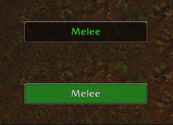

# RangeGauge



A small, draggable range indicator for your current target, built for **World of Warcraft: Forever** (interface `16001`).

It scratches the same itch as classic-era range checkers like [Egnar](https://github.com/Medeah/Egnar) on Turtle WoW, but it's built for Forever's modern, Retail-style API rather than vanilla 1.12 — so it works for any class, not just Hunters, and doesn't rely on any action-bar hacks.

## Features

- A small on-screen box that shows your target's range: `Melee`, `Close`, `Spell Range`, `Out of Range`, `Dead Zone`, `Target Dead`, or `No Range Info`.
- Automatically hides when you have no target.
- **Hunters** get an exact 8–35 yard read (including the vanilla dead zone) via Auto Shot's range check.
- Any class can point it at one of their own spells for a precise, class-specific range check.
- Draggable and resizable (grab the bottom-right corner while unlocked).
- Two display styles: colored text on a dark box, or a solid colored plate with white text.
- Position, size, lock state, color mode, and your chosen spell are all remembered between sessions.

## Installation

Drop the `RangeGauge` folder into:

```
World of Warcraft/_forever_/Interface/AddOns/
```

Then `/reload` or relaunch the client.

## Commands

| Command | Effect |
|---|---|
| `/rg` | Show the command list |
| `/rg spell <name or id>` | Track range for a specific spell instead of the generic distance buckets |
| `/rg clear` | Stop tracking a custom spell, back to generic detection |
| `/rg lock` | Lock the frame (also hides the resize grip) |
| `/rg unlock` | Unlock the frame so you can drag it or resize it from the bottom-right corner |
| `/rg colormode text` | Colored text on a dark box (default) |
| `/rg colormode bg` | Solid colored plate with white text |

## How it works

Forever runs Blizzard's Mainline UI on interface `16001`, not the vanilla 1.12 API. That means `CheckInteractDistance` and `C_Spell.IsSpellInRange` return plain, non-secret values against a hostile target, so RangeGauge just asks the API directly instead of reverse-engineering distance from action-bar cooldowns the way older vanilla-era addons had to.

- **Hunters:** Auto Shot (spell ID 75) reports a real 8–35 yard range, dead zone included, so Hunters get an exact read for free.
- **Everyone else (generic mode):** falls back to `CheckInteractDistance` buckets (~9.9 / 11.11 / 28 yd), with true melee contact confirmed by listening for a `PLAYER_SWING` main-hand event.
- **Custom spell mode (`/rg spell`):** uses `C_Spell.IsSpellInRange` directly against the chosen spell for a precise, non-bucketed answer.
- **Friendly targets in combat:** `CheckInteractDistance` can be blocked here, so RangeGauge skips it and shows `No Range Info` unless a spell check has already given an answer.

### Known limitation

On the beta, `C_SwingTimer.IsTargetWithinSwingRange` always returned `nil` (not yet re-checked on live), so RangeGauge doesn't use it for an exact 5-yard melee check. It approximates melee with the closest available interact-distance bucket and corroborates it with real `PLAYER_SWING` events.

## Compatibility

Built for WoW: Forever, interface `16001`. The client's API is largely undocumented, so the range checks this addon depends on may shift as Blizzard patches it.

## License

MIT — see [LICENSE](LICENSE).
